# Brix: a friendly data assistant in a bakery

Brix is an animated, talking assistant that runs as a **Databricks App** and answers questions in plain English from a **Genie** agent. It lives in a small bakery, and the objects in the room are live views of your data platform: the chalkboard is a dashboard, the tickets are job runs, the oven is pipeline health and the recipe book is the catalog.

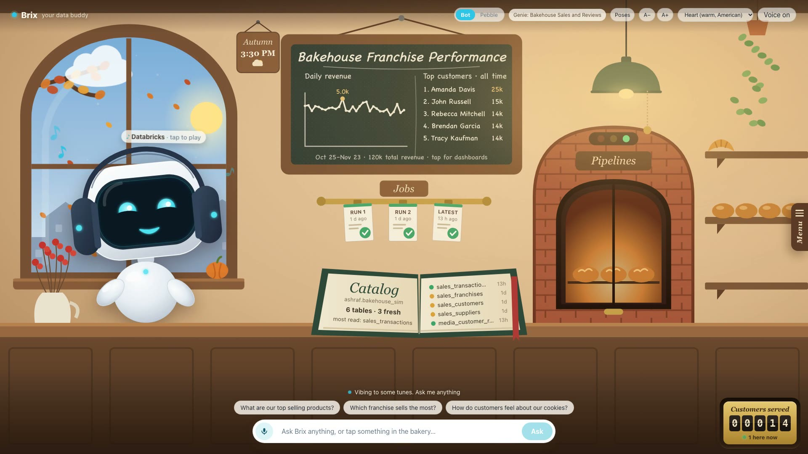

> The code will be published here soon. For now this repo holds the walkthrough videos and screenshots. The data shown is simulated Bakehouse demo data.

## Videos

**Watch in your browser: [ashrafosman.github.io/brix](https://ashrafosman.github.io/brix/)** · [tutorial](https://ashrafosman.github.io/brix/docs/videos/brix_tutorial.mp4) · [short](https://ashrafosman.github.io/brix/docs/videos/brix_tiktok.mp4)

| | |
|---|---|
| [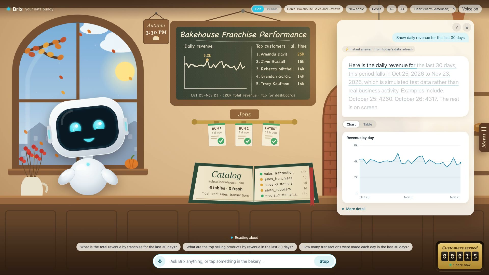](https://ashrafosman.github.io/brix/docs/videos/brix_tutorial.mp4) | [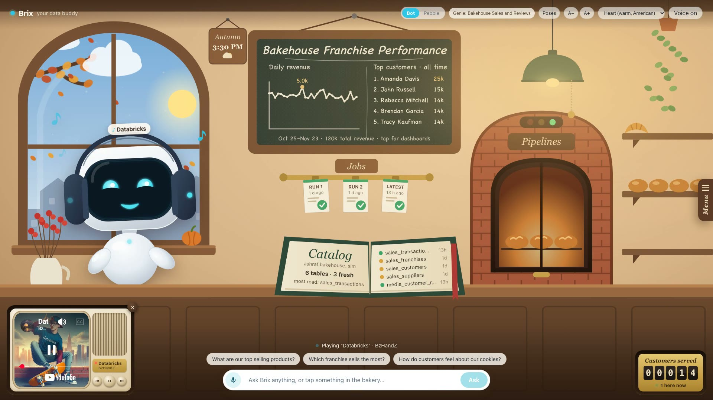](https://ashrafosman.github.io/brix/docs/videos/brix_tiktok.mp4) |
| **[Tutorial (2 min, 1080p)](https://ashrafosman.github.io/brix/docs/videos/brix_tutorial.mp4)**: a narrated tour of every feature. Captions are burned in, and also come as [a subtitle file](docs/videos/brix_tutorial.srt). | **[Short (30 s, vertical)](https://ashrafosman.github.io/brix/docs/videos/brix_tiktok.mp4)**: a fast cut in Brix's own voice, for Reels, Shorts and TikTok. |

## What Brix does

- **Ask anything.** Type or talk. Brix acts out what Genie is doing (finding the data, planning the query, running the numbers), then reads the answer aloud with lip-sync and shows a chart or a table.
- **Hands-free chat.** Turn the mic on and keep talking; follow-up questions keep their context.
- **A bakery that's live.**
  - **Chalkboard:** daily revenue and top customers from an AI/BI dashboard. Tap it to open your dashboards.
  - **Ticket rail:** the last three runs of the daily job, green or red.
  - **Oven:** the health of your pipelines.
  - **Recipe book:** the catalog, with how fresh each table is and which were read most recently.
  - **Window:** follows your local time, season and weather, with the real phase of the moon.
  - **Lamp:** pull the chain to dim the room and switch the panels to dark mode.
  - **Counter:** the number of customers served, plus one croissant for each person using Brix right now.
- **Alerts.** If the daily job fails, Brix tells you, with a link to the run.
- **Music.** When it's quiet, Brix vibes with headphones on. Tap to play songs on the little TV in the counter, and double-tap for the next one.
- **Two characters and two voices.** Bot and Pebble, voiced by Kokoro text-to-speech running inside the app, with the browser's own voice as a fallback.

## Screenshots

| | |
|---|---|
|  **An answer with a chart** | 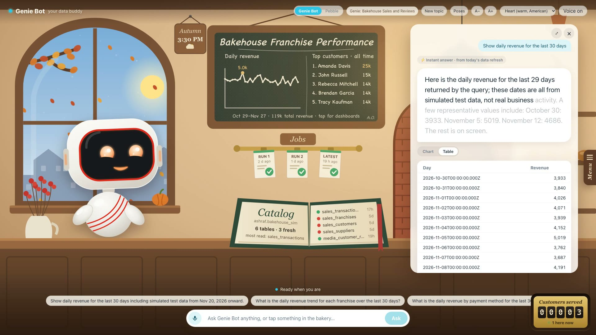 **The same answer as a table** |
| 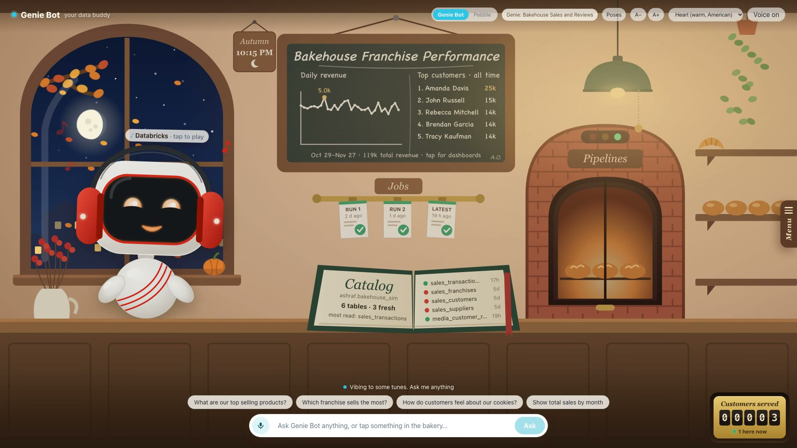 **At night: the real moon phase** | 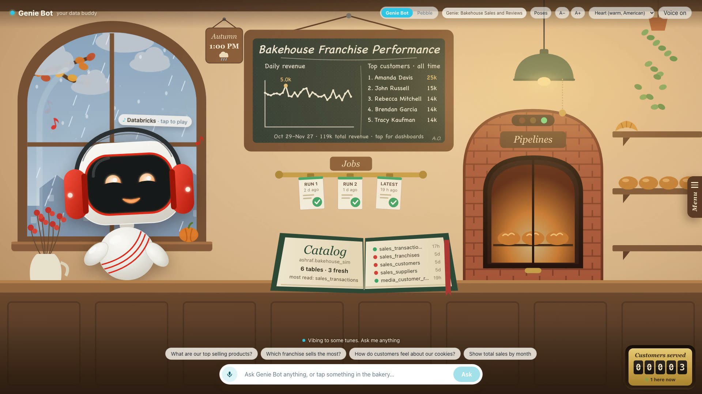 **Local weather in the window** |
| 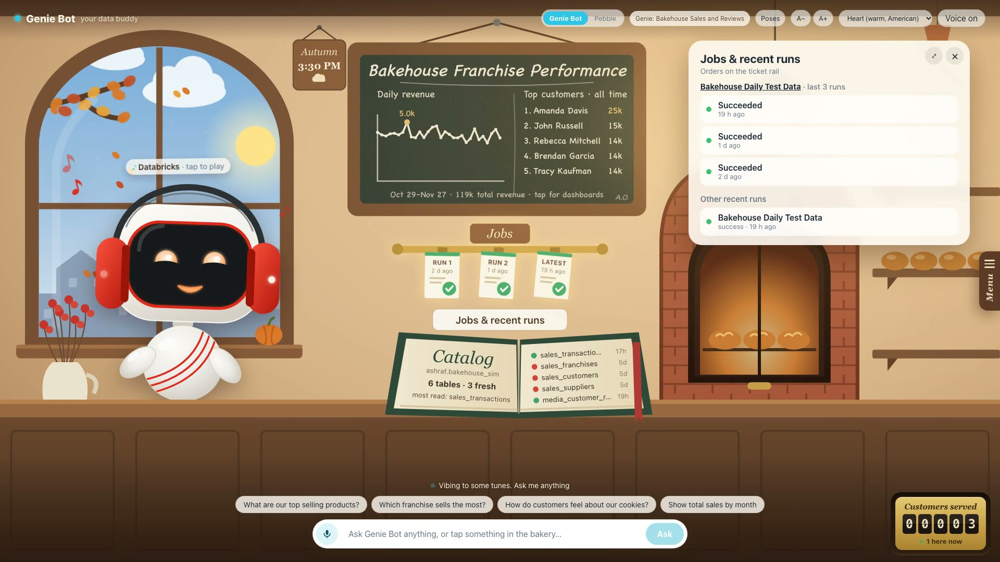 **Job runs from the ticket rail** | 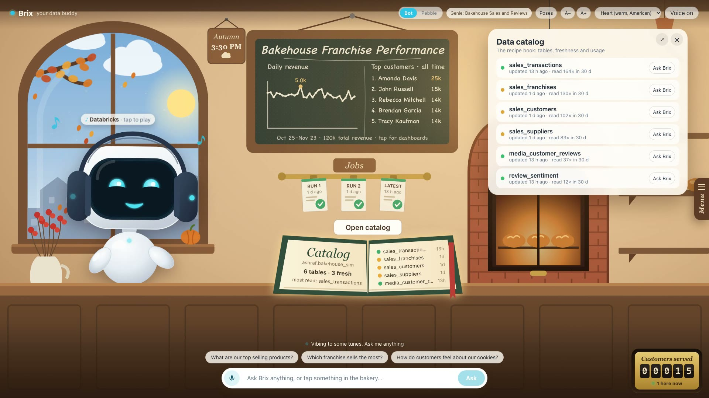 **Catalog freshness from the recipe book** |
| 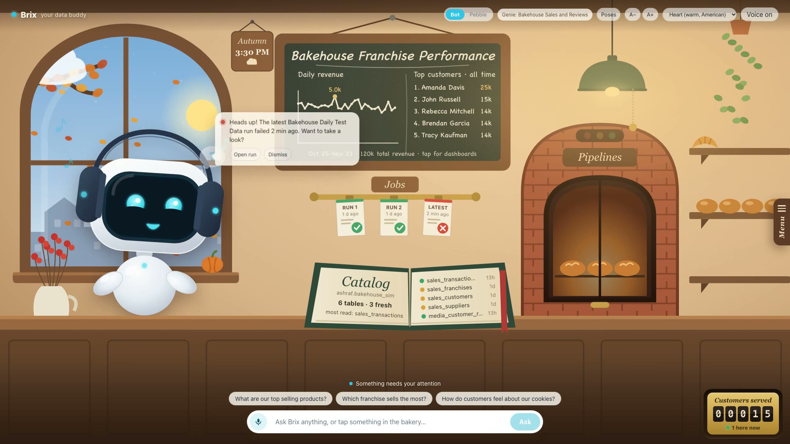 **A failed-job alert** | 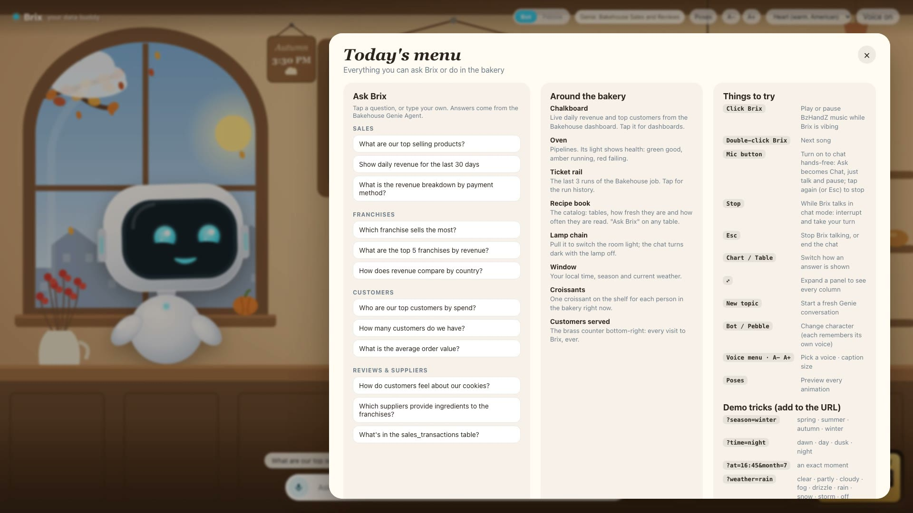 **The menu of things to ask and do** |
| 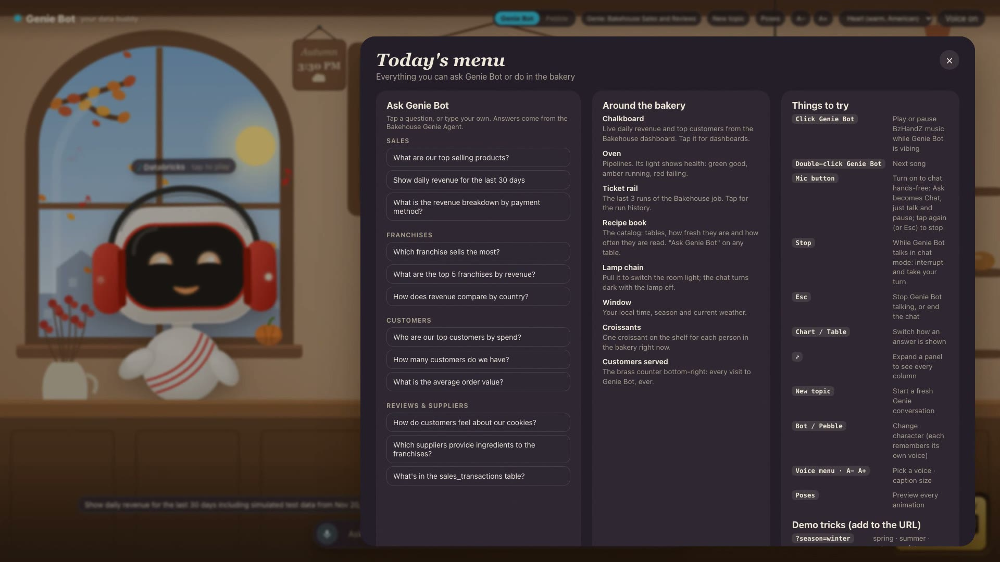 **Lamp off: dark mode** |  **The TV jukebox** |

## How it's built

- **Front end:** React, Vite and TypeScript. The bakery and characters are hand-built SVG, animated with `requestAnimationFrame`.
- **Back end:** FastAPI on Databricks Apps.
- **Answers:** a Genie agent, called through the Conversation API, with replies streamed so Brix can act out each phase.
- **Identity:** Genie, the chalkboard and the catalog run as the signed-in user through Databricks Apps user authorization, so people only see data they're allowed to see. Jobs, pipelines and dashboard listings use the app's own identity.
- **Voice:** Kokoro text-to-speech, with the model files stored in a Unity Catalog volume.
- **Speed and scale:**
  - Answers are cached until the data next refreshes, and the starter questions are warmed after each refresh.
  - Shared state (the answer cache, who's online, and each visitor's conversation) lives in **Lakebase**, so every app instance agrees and a redeploy loses nothing.
  - Review sentiment is computed ahead of time with `ai_analyze_sentiment` in the daily job.
- **Usage analytics:** every question is logged to a Delta table behind an AI/BI usage dashboard. The log stores the question and a random session ID, never names.
- **Accessibility:** built toward WCAG 2.1 AA.
  - Typing always works.
  - Speech can be stopped with Stop or Escape.
  - A screen-reader status announces when Brix is reading aloud.
  - Captions have adjustable size.
  - The bakery objects work from the keyboard.
  - Motion respects the reduced-motion setting.

  A full accessibility audit is still to do.
